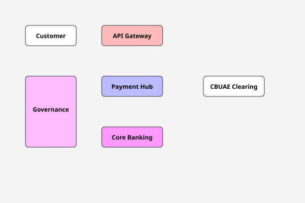

# UAE Retail-Bank Solution-Architect Skills Library

Welcome to the comprehensive skills library for UAE retail-bank solution architecture. This repository contains **invoke-and-act** Claude Code skills covering the complete solution-architecture lifecycle — from initial discovery through operational readiness.

## What is this library?

This library is a collection of 91 concrete, executable skills. Unlike static reference documentation, these are **active processes**. Each skill is invoked as a slash command (e.g., `/threat-model`) which triggers an interactive assessment or generation process.

Each skill features:
- **Embedded Checklists & Pitfalls:** Banking-specific and UAE-specific constraints, common anti-patterns, and step-by-step checklists.
- **Industry-framework Grounding:** Inline and actionable alignment with BIAN, TOGAF, C4, AWS Well-Architected, Azure CAF, OWASP, NIST, SRE, and ITIL 4 frameworks.
- **Concrete Deliverables:** Every skill produces an explicit artifact (e.g., a high-level design document, a risk register, a platform evaluation report).

## How to Use

Skills are designed to be invoked sequentially through the structural lifecycle phases of architecture. You can invoke them using their short, unprefixed names (e.g., `/solution-options`).

**The Lifecycle Throughline:**
1. **Discovery & Assessment (`discovery/`, `modernization/`, `greenfield/`)** -> Understand the landscape. Map capabilities, assess legacy tech debt, and evaluate candidate target platforms.
2. **Planning & Strategy (`migration/`, `architecture/`)** -> Establish the blueprints and transition roadmaps. Map high-level/low-level designs, target non-functional requirements (NFRs), and sequence migration waves.
3. **Secure & Integrate Early (`security/`, `integration/`)** -> Front-load risk. Enforce enterprise zero-trust, IAM best practices, API designs, and messaging models before any coding happens.
4. **Platform & Validation (`cloud/`, `devops/`)** -> Ensure continuous quality and readiness. Verify well-architected cloud footprint, CI/CD checks, and release gates.
5. **Governance Gates & Tracking (`governance/`, `documentation/`)** -> Manage lifecycle status. Present to architecture boards, gate production releases, and continuously maintain RAID logs and risk registers.

## Architecture Overview

For the detailed Mermaid specification, see [Project Architecture Overview](diagram-templates/project-overview.md).

### AI & ML Architecture
- **[ai-ethics-review](ai-ml-architecture/ai-ethics-review/SKILL.md)** — `Ai Ethics Review skill` Invoke with: `/ai-ethics-review`
- **[feature-store-design](ai-ml-architecture/feature-store-design/SKILL.md)** — `Feature Store Design skill` Invoke with: `/feature-store-design`
- **[ml-ops-design](ai-ml-architecture/ml-ops-design/SKILL.md)** — `Ml Ops Design skill` Invoke with: `/ml-ops-design`
- **[ml-pipeline-architecture](ai-ml-architecture/ml-pipeline-architecture/SKILL.md)** — `Ml Pipeline Architecture skill` Invoke with: `/ml-pipeline-architecture`
- **[model-governance](ai-ml-architecture/model-governance/SKILL.md)** — `Model Governance skill` Invoke with: `/model-governance`
- **[rag-patterns](ai-ml-architecture/rag-patterns/SKILL.md)** — `Rag Patterns skill` Invoke with: `/rag-patterns`

### Architecture
- **[architecture-decision-records](architecture/architecture-decision-records/SKILL.md)** — `No description provided.` Invoke with: `/architecture-decision-records`
- **[architecture-review](architecture/architecture-review/SKILL.md)** — `No description provided.` Invoke with: `/architecture-review`
- **[c4-model](architecture/c4-model/SKILL.md)** — `No description provided.` Invoke with: `/c4-model`
- **[database-design](architecture/database-design/SKILL.md)** — `Database Design skill` Invoke with: `/database-design`
- **[deployment-diagrams](architecture/deployment-diagrams/SKILL.md)** — `No description provided.` Invoke with: `/deployment-diagrams`
- **[hld-generator](architecture/hld-generator/SKILL.md)** — `No description provided.` Invoke with: `/hld-generator`
- **[lld-generator](architecture/lld-generator/SKILL.md)** — `No description provided.` Invoke with: `/lld-generator`
- **[nfr-checklist](architecture/nfr-checklist/SKILL.md)** — `No description provided.` Invoke with: `/nfr-checklist`
- **[sequence-diagrams](architecture/sequence-diagrams/SKILL.md)** — `No description provided.` Invoke with: `/sequence-diagrams`

### Business Architecture
- **[business-case-development](business-architecture/business-case-development/SKILL.md)** — `Business Case Development skill` Invoke with: `/business-case-development`
- **[business-process-modeling](business-architecture/business-process-modeling/SKILL.md)** — `Business Process Modeling skill` Invoke with: `/business-process-modeling`
- **[capability-mapping](business-architecture/capability-mapping/SKILL.md)** — `Capability Mapping skill` Invoke with: `/capability-mapping`
- **[org-design](business-architecture/org-design/SKILL.md)** — `Org Design skill` Invoke with: `/org-design`
- **[stakeholder-analysis](business-architecture/stakeholder-analysis/SKILL.md)** — `Stakeholder Analysis skill` Invoke with: `/stakeholder-analysis`
- **[value-stream-design](business-architecture/value-stream-design/SKILL.md)** — `Value Stream Design skill` Invoke with: `/value-stream-design`

### Cloud
- **[aws-review](cloud/aws-review/SKILL.md)** — `No description provided.` Invoke with: `/aws-review`
- **[azure-review](cloud/azure-review/SKILL.md)** — `No description provided.` Invoke with: `/azure-review`
- **[gcp-review](cloud/gcp-review/SKILL.md)** — `No description provided.` Invoke with: `/gcp-review`
- **[kubernetes](cloud/kubernetes/SKILL.md)** — `No description provided.` Invoke with: `/kubernetes`
- **[landing-zone-review](cloud/landing-zone-review/SKILL.md)** — `No description provided.` Invoke with: `/landing-zone-review`
- **[terraform](cloud/terraform/SKILL.md)** — `No description provided.` Invoke with: `/terraform`

### Data Architecture
- **[data-governance](data-architecture/data-governance/SKILL.md)** — `Data Governance skill` Invoke with: `/data-governance`
- **[data-lineage](data-architecture/data-lineage/SKILL.md)** — `Data Lineage skill` Invoke with: `/data-lineage`
- **[data-modeling](data-architecture/data-modeling/SKILL.md)** — `Data Modeling skill` Invoke with: `/data-modeling`
- **[data-privacy-assessment](data-architecture/data-privacy-assessment/SKILL.md)** — `Data Privacy Assessment skill` Invoke with: `/data-privacy-assessment`
- **[data-quality](data-architecture/data-quality/SKILL.md)** — `Data Quality skill` Invoke with: `/data-quality`
- **[master-data-management](data-architecture/master-data-management/SKILL.md)** — `Master Data Management skill` Invoke with: `/master-data-management`

### Devops
- **[cicd-review](devops/cicd-review/SKILL.md)** — `No description provided.` Invoke with: `/cicd-review`
- **[finops-strategy](devops/finops-strategy/SKILL.md)** — `Finops Strategy skill` Invoke with: `/finops-strategy`
- **[observability](devops/observability/SKILL.md)** — `No description provided.` Invoke with: `/observability`
- **[performance-review](devops/performance-review/SKILL.md)** — `No description provided.` Invoke with: `/performance-review`
- **[release-readiness](devops/release-readiness/SKILL.md)** — `No description provided.` Invoke with: `/release-readiness`
- **[sre-review](devops/sre-review/SKILL.md)** — `No description provided.` Invoke with: `/sre-review`

### Discovery
- **[business-capability-map](discovery/business-capability-map/SKILL.md)** — `No description provided.` Invoke with: `/business-capability-map`
- **[gap-analysis](discovery/gap-analysis/SKILL.md)** — `No description provided.` Invoke with: `/gap-analysis`
- **[requirements-analysis](discovery/requirements-analysis/SKILL.md)** — `No description provided.` Invoke with: `/requirements-analysis`
- **[solution-options](discovery/solution-options/SKILL.md)** — `No description provided.` Invoke with: `/solution-options`
- **[stakeholder-workshop](discovery/stakeholder-workshop/SKILL.md)** — `No description provided.` Invoke with: `/stakeholder-workshop`

### Documentation
- **[design-document](documentation/design-document/SKILL.md)** — `No description provided.` Invoke with: `/design-document`
- **[executive-summary](documentation/executive-summary/SKILL.md)** — `No description provided.` Invoke with: `/executive-summary`
- **[project-charter](documentation/project-charter/SKILL.md)** — `No description provided.` Invoke with: `/project-charter`
- **[proposal](documentation/proposal/SKILL.md)** — `No description provided.` Invoke with: `/proposal`
- **[raid-log](documentation/raid-log/SKILL.md)** — `No description provided.` Invoke with: `/raid-log`
- **[risk-register](documentation/risk-register/SKILL.md)** — `No description provided.` Invoke with: `/risk-register`

### Governance
- **[ai-governance](governance/ai-governance/SKILL.md)** — `Ai Governance skill` Invoke with: `/ai-governance`
- **[ai-model-governance](governance/ai-model-governance/SKILL.md)** — `Ai Model Governance skill` Invoke with: `/ai-model-governance`
- **[architecture-board](governance/architecture-board/SKILL.md)** — `No description provided.` Invoke with: `/architecture-board`
- **[cross-domain-impact-assessment](governance/cross-domain-impact-assessment/SKILL.md)** — `Evaluates proposed architectural changes across business, data, application, and technology domains to identify cascading dependencies and risks.` Invoke with: `/cross-domain-impact-assessment`
- **[design-review](governance/design-review/SKILL.md)** — `No description provided.` Invoke with: `/design-review`
- **[dr-review](governance/dr-review/SKILL.md)** — `No description provided.` Invoke with: `/dr-review`
- **[evidence-gate](governance/evidence-gate/SKILL.md)** — `Tests architectural claims against real project repository state to ensure compliance and prevent hallucination.` Invoke with: `/evidence-gate`
- **[operational-readiness](governance/operational-readiness/SKILL.md)** — `No description provided.` Invoke with: `/operational-readiness`
- **[production-readiness](governance/production-readiness/SKILL.md)** — `No description provided.` Invoke with: `/production-readiness`
- **[security-nfr-baseline-check](governance/security-nfr-baseline-check/SKILL.md)** — `Security Nfr Baseline Check skill` Invoke with: `/security-nfr-baseline-check`
- **[solution-review](governance/solution-review/SKILL.md)** — `No description provided.` Invoke with: `/solution-review`

### Greenfield
- **[platform-selection](greenfield/platform-selection/SKILL.md)** — `No description provided.` Invoke with: `/platform-selection`
- **[poc-planning](greenfield/poc-planning/SKILL.md)** — `No description provided.` Invoke with: `/poc-planning`
- **[reference-architecture](greenfield/reference-architecture/SKILL.md)** — `No description provided.` Invoke with: `/reference-architecture`
- **[roadmap](greenfield/roadmap/SKILL.md)** — `No description provided.` Invoke with: `/roadmap`
- **[technology-evaluation](greenfield/technology-evaluation/SKILL.md)** — `No description provided.` Invoke with: `/technology-evaluation`

### Integration
- **[api-design](integration/api-design/SKILL.md)** — `Api Design skill` Invoke with: `/api-design`
- **[data-sync](integration/data-sync/SKILL.md)** — `No description provided.` Invoke with: `/data-sync`
- **[etl](integration/etl/SKILL.md)** — `No description provided.` Invoke with: `/etl`
- **[event-driven](integration/event-driven/SKILL.md)** — `No description provided.` Invoke with: `/event-driven`
- **[idempotent-api](integration/idempotent-api/SKILL.md)** — `Idempotent Api skill` Invoke with: `/idempotent-api`
- **[integration-patterns](integration/integration-patterns/SKILL.md)** — `No description provided.` Invoke with: `/integration-patterns`
- **[messaging](integration/messaging/SKILL.md)** — `No description provided.` Invoke with: `/messaging`

### Internal Utilities
- **[tdd-documentation](.claude/tdd-documentation/SKILL.md)** — `Use when authoring or refactoring skills (SKILL.md) to ensure disciplined, TDD-based construction.` Invoke with: `/tdd-documentation`

### Migration
- **[application-migration](migration/application-migration/SKILL.md)** — `No description provided.` Invoke with: `/application-migration`
- **[cloud-migration](migration/cloud-migration/SKILL.md)** — `No description provided.` Invoke with: `/cloud-migration`
- **[cutover-plan](migration/cutover-plan/SKILL.md)** — `No description provided.` Invoke with: `/cutover-plan`
- **[database-migration](migration/database-migration/SKILL.md)** — `No description provided.` Invoke with: `/database-migration`
- **[migration-wave-planning](migration/migration-wave-planning/SKILL.md)** — `No description provided.` Invoke with: `/migration-wave-planning`
- **[rollback-plan](migration/rollback-plan/SKILL.md)** — `No description provided.` Invoke with: `/rollback-plan`

### Modernization
- **[impact-analysis](modernization/impact-analysis/SKILL.md)** — `No description provided.` Invoke with: `/impact-analysis`
- **[legacy-assessment](modernization/legacy-assessment/SKILL.md)** — `No description provided.` Invoke with: `/legacy-assessment`
- **[modernization-roadmap](modernization/modernization-roadmap/SKILL.md)** — `No description provided.` Invoke with: `/modernization-roadmap`
- **[refactoring-plan](modernization/refactoring-plan/SKILL.md)** — `No description provided.` Invoke with: `/refactoring-plan`
- **[technical-debt](modernization/technical-debt/SKILL.md)** — `No description provided.` Invoke with: `/technical-debt`

### Visual Understanding
- **[architecture-overview](diagram-templates/project-overview.md)** — `High-level architecture overview`

### Security
- **[adversarial-compliance](security/adversarial-compliance/SKILL.md)** — `Red-teaming test suite that attempts to bypass data-residency and compliance guardrails.` Invoke with: `/adversarial-compliance`
- **[compliance](security/compliance/SKILL.md)** — `Compliance skill` Invoke with: `/compliance`
- **[iam-review](security/iam-review/SKILL.md)** — `No description provided.` Invoke with: `/iam-review`
- **[owasp-review](security/owasp-review/SKILL.md)** — `No description provided.` Invoke with: `/owasp-review`
- **[security-architecture-review](security/security-architecture-review/SKILL.md)** — `No description provided.` Invoke with: `/security-architecture-review`
- **[threat-model](security/threat-model/SKILL.md)** — `No description provided.` Invoke with: `/threat-model`
- **[zero-trust](security/zero-trust/SKILL.md)** — `No description provided.` Invoke with: `/zero-trust`

## Cross-Link Navigation

Each `.md` document includes a "Related Skills" or "Inputs/Outputs" section in its frontmatter metadata enabling navigation across the graph.
For example, you might flow from `/gap-analysis` -> `/solution-options` -> `/architecture-board`.

**Core Orchestration:** Use `/orchestrator` located in `wayfinder/` to orchestrate agents automatically executing these sequences.
